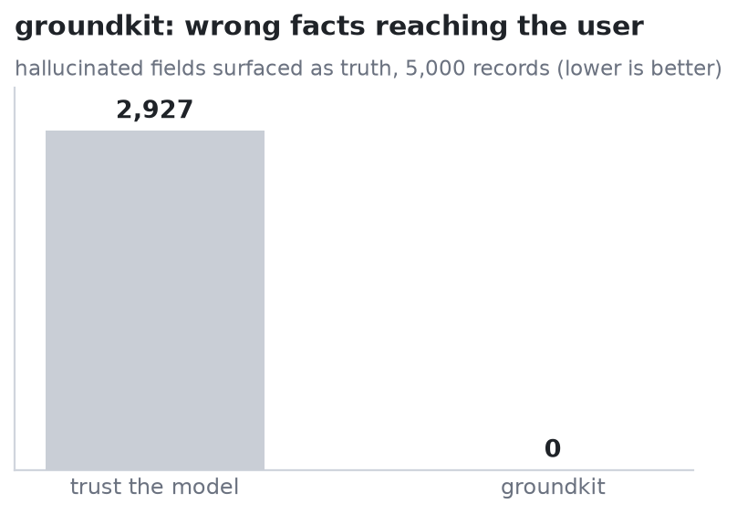

# groundkit

[](https://github.com/ss1738/groundkit/actions/workflows/ci.yml)
[](LICENSE)

**Deterministic-first grounding for LLM output.** A model can *propose*, but it
can never *assert a fact*. groundkit checks structured claims against an
authoritative source and free-text answers against retrieved evidence, tags every
value with its **provenance**, and guarantees nothing unverified is silently
presented as truth. Pure Python, zero dependencies.

```python
from groundkit import FactStore, ground_record, trusted

store  = FactStore({"capital_of_france": "Paris", "ceo_of_acme": "Jane Doe"})
record = {
    "capital_of_france": "Lyon",   # model got it wrong (source says Paris)
    "ceo_of_acme": "Jane Doe",     # right
    "acme_founded": "1990",        # unverifiable, not in the source
}

grounded = ground_record(store, record)
grounded["capital_of_france"].provenance   # Provenance.CONTRADICTED  -> value "Paris" (source wins)
grounded["acme_founded"].provenance        # Provenance.ADVISORY      -> kept, but labelled
trusted(grounded)                          # {"ceo_of_acme": "Jane Doe"}  -- safe to present as fact
```

## The pattern

Two layers, borrowed from how you'd build a system you actually trust:

- **Layer 1: deterministic.** Facts are checked against an authoritative source
  (a register, a database, retrieved passages). Exact, no model involved. A claim
  is `VERIFIED`, `CONTRADICTED` (and the *source* value is kept, never the
  model's), or `ADVISORY` (no record to check it against).
- **Layer 2: advisory only.** Whatever an LLM contributes is, by construction,
  tagged `ADVISORY`. It's never promoted to fact.

Every value comes back as a `Grounded(value, provenance, source, note)`, so the
caller always knows what's trustworthy. `trusted()` hands you only the `VERIFIED`
subset.

## Benchmark: wrong facts reaching the user

`benchmarks/bench_grounding.py`: 5,000 records, a model hallucinating 20% of
verifiable fields, plus unverifiable extras:

| Policy | Wrong facts surfaced as truth |
|---|---|
| Trust the model | 2,927 |
| **groundkit** | **0** |



groundkit catches **100%** of hallucinated fields deterministically (the
authoritative value is kept) and labels every unverifiable claim `ADVISORY`
instead of asserting it.

## RAG answer faithfulness

`ground_text` checks each sentence of an answer against the passages it was
supposed to use:

```python
from groundkit import ground_text

sources = ["The Eiffel Tower was completed in 1889.", "It stands 330 m tall in Paris."]
answer  = "The Eiffel Tower was completed in 1889. It is the most visited monument on Earth."

report = ground_text(answer, sources)
report.faithful            # False -- the 2nd sentence isn't supported
report.unsupported         # [SentenceVerdict("It is the most visited monument on Earth.", ...)]
report.redacted()          # "The Eiffel Tower was completed in 1889."
report.flagged()           # "... 1889. It is the most visited monument on Earth. [UNSUPPORTED]"
```

Two deterministic checks run, both dependency-free. Content-word overlap flags
sentences whose substance is absent from the evidence (the common RAG failure).
Quantity parity then requires every figure the sentence asserts to appear in the
evidence:

```python
ground_text("Refunds are issued within 30 days.",
            ["Refunds are issued within 14 days."])
# supported: False, score: 0.875, reason: "quantity absent from the evidence: 30 day"
```

Overlap alone scores that 0.875 and passes it. The quantity check catches wrong
numbers, durations, percentages, currency amounts and doses, converting only
where the conversion is exact (`two weeks` and `14 days` are the same quantity;
a month is never 30 days). Pass `check_quantities=False` to disable it.

Neither check is entailment. A **negation or antonym** swapped into an otherwise
grounded sentence still passes, so use an NLI model where that matters. For exact
wrong-value detection on fields you can extract, use the structured layer above.

## Scope: grounding is not freshness

groundkit answers **"is this answer supported by the evidence it was given?"** It
does not answer **"is that evidence still current?"** Those are separate claims and
groundkit only makes the first one.

Concretely: index a policy saying "refunds within 30 days", answer from it, then
change the authoritative policy to 14 days while the old chunk stays in your index.
`ground_text` still returns `VERIFIED` with a support score of 1.0. The answer
matches its retrieved source perfectly and is wrong about current policy. The same
holds for `FactStore`: a store loaded from stale data returns `VERIFIED`, because
nothing records when it was loaded.

Note the quantity check does not help here, and cannot. It compares the answer
against the evidence it was given; when the evidence itself is the stale chunk,
the figures agree. Fresh evidence with a wrong figure is caught; stale evidence
faithfully quoted is not.

There is **no revision or staleness hook**. `Grounded.source` is a free-text label,
not a document id, revision hash or fetched-at time, and nothing in the library
compares one to the live source. Keeping the indexed snapshot current is the
ingestion pipeline's job. If you need both claims, track revision and fetched-at
beside each chunk and check them separately, then treat "supported by this snapshot"
and "snapshot still current" as two results rather than making attribution carry
both.

Within a single snapshot both layers catch wrong values:
`verify_claim(FactStore({"refund_window_days": 14}), "refund_window_days", 30)`
returns `CONTRADICTED` and keeps 14, and `ground_text` flags the same swap in free
text through quantity parity.

## API

- **`FactStore(facts)`**: `.has` / `.get` / `.matches` / `.add`, whitespace- and
  case-normalised comparison.
- **`ground_record(store, record) -> {key: Grounded}`**, **`verify_claim(...)`**
- **`trusted(grounded)`**: VERIFIED values only. **`contradictions(grounded)`**.
- **`ground_text(answer, sources, threshold=0.6, check_quantities=True) ->
  GroundingReport`** with `.faithful`, `.supported_ratio`, `.unsupported`,
  `.flagged()`, `.redacted()`. Each `.sentences[i]` is a `SentenceVerdict`
  carrying `.supported`, `.score`, `.reason` and `.provenance`
  (`VERIFIED` / `UNSUPPORTED`).
- **`extract_quantities(text)`**, **`unsupported_quantities(sentence, sources)`**
  from `groundkit.quantities`, if you want the figures directly.
- **`Provenance`**: `VERIFIED` · `CONTRADICTED` · `ADVISORY` · `UNSUPPORTED`.

## Install

```bash
git clone https://github.com/ss1738/groundkit
cd groundkit && pip install -e .
```

Not published on PyPI. The name `groundkit` there belongs to an unrelated project,
so `pip install groundkit` does **not** install this library. Python ≥ 3.9, no
runtime dependencies.

## Related

Part of a set of four small libraries for not trusting an unverified LLM output:

- [stigma](https://github.com/ss1738/stigma): aggregate many models with consensus that learns which to trust
- [disco](https://github.com/ss1738/disco): search with a verifier (an open FunSearch)
- **groundkit** (this repo): ground a model's output against a source
- [certain](https://github.com/ss1738/certain): calibrate confidence and abstain

## License

MIT © 2026 Satyawan Singh
